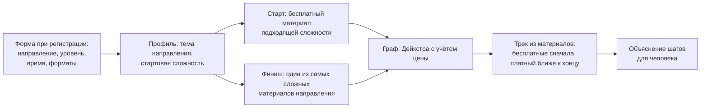
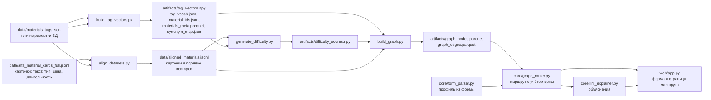

# mf_graph

Граф материалов «Альфа-Курса». Связи в графе идут от простых материалов к сложным, на основе чего далее строятся учебные треки.

Проект сделан для хакатона «Альфа-Курс», трек 1 (персональные рекомендации образовательных материалов).

## Главное о проекте

**Задача.** Повысить среднюю конверсию в покупку образовательных продуктов и число дней, в которые пользователь заходит на платформу.

**Проблема.** В каталоге большое количество материалов, и пользователю трудно понять, с чего начать и что изучать дальше.

**Идея.** При регистрации пользователь заполняет форму из трёх шагов. Он выбирает направление и уровень подготовки, отмечает, что уже знает, и указывает часы в неделю, срок и форматы обучения. Ответы нужны для персональных рекомендаций. Далее по графу строится путь от начальной точки до конечной по материалам подходящей сложности. Путь начинается с бесплатных материалов, а платный предлагается ближе к концу и сопровождается объяснением. Подробности в разделе [Как это работает для пользователя](#как-это-работает-для-пользователя).

**Что сделали.** Для каждого материала посчитали вектор по темам и тегам и оценку сложности. Похожие материалы соединили связями от менее сложного к более сложному.

**Результат.**
- 6 789 связей между материалами, циклов нет.
- Почти все материалы лежат в одной связной части, маршрут можно построить почти от любой точки.
- Пример маршрута из 4 материалов по налоговой теме описан ниже.
- Весь расчёт занимает несколько секунд.

**Связь с прибылью.** Мы предполагаем, что человек, который видит следующий шаг подходящей сложности, дольше остаётся в каталоге и чаще доходит до платных курсов. Гипотеза и план проверки описаны в разделе [Гипотеза влияния на конверсию и план проверки](#гипотеза-влияния-на-конверсию-и-план-проверки).

## Содержание

1. [Главное о проекте](#главное-о-проекте)
2. [Быстрый старт](#быстрый-старт)
3. [Пример результата](#пример-результата)
4. [Как это работает для пользователя](#как-это-работает-для-пользователя)
5. [Как маршрут связан с продажей](#как-маршрут-связан-с-продажей)
6. [Гипотеза влияния на конверсию и план проверки](#гипотеза-влияния-на-конверсию-и-план-проверки)
7. [Архитектура](#архитектура)
8. [Структура репозитория](#структура-репозитория)
9. [Входные данные](#входные-данные)
10. [Запуск подробно](#запуск-подробно)
11. [Переменные окружения, порты, зависимости](#переменные-окружения-порты-зависимости)
12. [Пошаговая проверка](#пошаговая-проверка)
13. [Артефакты](#артефакты)
14. [Как устроен расчёт](#как-устроен-расчёт)
15. [Добавление новых материалов](#добавление-новых-материалов)
16. [Известные ограничения](#известные-ограничения)
17. [Идеи для рекомендаций](#идеи-для-рекомендаций)
18. [Дополнительные инструменты](#дополнительные-инструменты)
19. [Команда](#команда)

## Быстрый старт

Нужны Docker и Docker Compose. В корне репозитория выполните:

```bash
docker compose up --build
```

Контейнер соберёт граф (четыре шага, несколько секунд) и запустит сайт. Первая сборка образа может занять несколько минут, потому что ставятся зависимости. Когда в логе появится запуск сервера, откройте в браузере http://localhost:5000. На главной странице лежит форма, а маршрут появится после кнопки «Сформировать маршрут».

Без Docker нужен Python 3.10, затем `pip install -r requirements.txt` и `python run_all.py`. Подробности в разделе [Запуск подробно](#запуск-подробно).

## Пример результата

Два маршрута, которые строит сайт для уровня «С нуля». Цены и длительность взяты из карточек материалов.

**Направление «Налоги и право».** Все шаги бесплатные.

| Шаг | Материал | Сложность | Время | Цена |
|-----|----------|-----------|-------|------|
| 1 | Как пополнить единый налоговый счёт: видеоинструкция | 0,38 | 4 мин | бесплатно |
| 2 | Как работать на УСН с 2025 года | 0,53 | 2 мин | бесплатно |
| 3 | Может ли ИП открыть ООО и быть его учредителем | 0,58 | 8 мин | бесплатно |
| 4 | Налоговая реформа 2026 года: что может измениться для ИП и ООО | 0,90 | 13 мин | бесплатно |

**Направление «Маркетинг и бренд».** Последний шаг платный.

| Шаг | Материал | Сложность | Время | Цена |
|-----|----------|-----------|-------|------|
| 1 | Что такое маркетинг 360 и как он работает? | 0,25 | 17 мин | бесплатно |
| 2 | Что такое МСС-код и для чего он нужен | 0,32 | 7 мин | бесплатно |
| 3 | Что такое устав ООО и для чего он нужен | 0,47 | 8 мин | бесплатно |
| 4 | Маркетплейсы: с чего начать и как преуспеть | 0,58 | 2 ч | бесплатно |
| 5 | Интернет-маркетинг: разбираемся с экспертами | 0,68 | 2 ч | 2 990 ₽ в месяц по подписке |

Во втором маршруте видно, как работает логика продажи. Четыре шага человек проходит бесплатно, а курс с ценой встаёт в конец. Видно и слабое место. Шаги 2 и 3 по теме ближе к общим вопросам бизнеса, чем к маркетингу. Это описано в разделе [Известные ограничения](#известные-ограничения).

Проверочный маршрут из `build_graph.py` совпадает с первой таблицей. Скрипт берёт самый простой и самый сложный материал со словом «налог» в заголовке и ищет между ними путь по графу.

## Как это работает для пользователя



1. **Форма.** При регистрации человеку предлагают заполнить форму из трёх шагов. На первом он выбирает направление из 11, например «Налоги и право» или «Продажи и клиенты», и по желанию пишет цель своими словами. На втором он выбирает уровень подготовки (с нуля, знаю основы, есть опыт, работаю в сфере) и отмечает темы, которые уже знает. На третьем он задаёт часы в неделю, срок достижения цели и форматы обучения (курсы, статьи и книги, вебинары, подкасты). Поля про бюджет в форме нет. Почти все поля выбираются из списков, единственное текстовое поле это необязательная цель.
2. **Профиль.** Из ответов собирается профиль. Направление переводится в тему каталога, а уровень подготовки задаёт стартовую сложность на шкале графа (от 0,1 до 0,9). Эти шаги выполняет обычный код в `core/form_parser.py`, языковая модель для них не нужна.
3. **Старт.** Среди материалов выбранной темы алгоритм берёт бесплатный материал, сложность которого ближе всего к уровню человека. Если бесплатных в теме нет, берётся любой.
4. **Финиш.** Алгоритм смотрит на верхние 30 % материалов темы по сложности. Если среди них есть платные, финишем становится самый дорогой из них. Если платных нет, финишем становится самый сложный материал.
5. **Путь.** Алгоритм Дейкстры ищет путь от старта к финишу. Рёбра идут от менее сложного материала к более сложному, поэтому путь поднимается по сложности и не зацикливается. Цена не служит фильтром, у каждого ребра есть стоимость, и она зависит от цены материала, к которому ведёт ребро. Подробно это описано в разделе [Как маршрут связан с продажей](#как-маршрут-связан-с-продажей).
6. **Объяснение.** Для каждого шага и для всего маршрута формируется короткий текст. В нём сказано, почему трек начинается с этого материала, как растёт сложность и чем полезен платный шаг в конце. Тексты формирует `core/llm_explainer.py`, в нём же подключается языковая модель.

Форму и страницу результата отдаёт Flask-сервис из папки `web/`.

### Подключение языковой модели

В боевой версии языковая модель берёт на себя два места. Первое это выбор финиша по тексту цели из формы вместо правила «верхние 30 % по сложности». Второе это живой текст объяснения вместо шаблона. Обмен идёт через JSON.

В модель уходят ответы формы и список подходящих материалов направления.

```json
{
  "form": {
    "direction": "Налоги и право",
    "level": "zero",
    "goal_text": "Хочу разобраться в налоговой реформе 2026",
    "known_topics": ["Постановка целей"],
    "hours_per_week": 5,
    "deadline": "Комфортно (3-6 месяцев)",
    "formats": ["Статьи/книги", "Вебинары"]
  },
  "catalog": [{"id": "<ID материала>", "title": "...", "type": "article", "difficulty": 0.38, "topics": ["Налоги и законы"]}]
}
```

В ответ модель возвращает конечную точку. Стартовую сложность и ограничения код берёт из формы сам.

```json
{"end_item_id": "<ID материала из списка>"}
```

Правила, которые нужны для надёжной работы.

- Код проверяет, что `end_item_id` есть в графе. Если ID неверный, запрос к модели повторяется.
- Если конечная точка проще стартовой или до неё нет пути по рёбрам, код берёт ближайший достижимый материал выше по сложности.
- В запрос попадают только материалы выбранного направления, подходящие по формату. Если их слишком много, список сокращается до ближайших по сложности.
- Если человек пропустил форму, персонального трека нет. Система показывает стартовую подборку по самой популярной теме и объясняет её порядок.
- В модель уходят только ответы формы (включая текст цели), а также ID, заголовки, типы, сложность и темы материалов. Рядом с полем цели просим не писать личные данные. Персональные данные и тексты материалов не передаются.
- Для платных материалов в объяснении даётся только короткая польза и ссылка на страницу материала, подробное содержание не раскрывается.
- Модель можно заменить. Подойдёт внешняя LLM или собственный сервис, лишь бы он принимал и возвращал JSON в таком виде.

## Как маршрут связан с продажей

Мы не даём пользователю фильтр по цене. Платформа зарабатывает на платных курсах, и фильтр «только бесплатное» убрал бы их вместе с выручкой. Поэтому цена входит в сам алгоритм. Идея похожа на построение маршрута в картографических сервисах. У каждого ребра графа есть стоимость, а путь выбирается по общей стоимости, а не по числу шагов.

**Стоимость ребра.** Базовая стоимость ребра равна `1 - сходство`, как в проверочном маршруте. Для ребра, которое ведёт к платному материалу, к ней добавляется поправка.

| Куда ведёт ребро | Поправка | Что она делает |
|------------------|----------|----------------|
| Бесплатный материал | нет | путь идёт через бесплатные материалы как обычно |
| Платный материал со сложностью до 0,5 | +0,5 | платное в начале пути невыгодно, алгоритм его обходит |
| Платный материал со сложностью выше 0,5 | −0,1 | ближе к концу пути платное становится выгоднее |

**Вовлечённость.** В реальном сервисе момент предложения должен зависеть от вовлечённости человека, то есть от числа пройденных материалов и дней захода. Журнала активности в данных нет, поэтому в прототипе вовлечённость заменяет положение в маршруте. Чем выше сложность материала, тем дальше человек ушёл по треку. Порог 0,5 подобран вручную. Когда появятся данные о поведении пользователей, порог заменяется реальным сигналом, а проверка гипотезы 6 покажет, в какой момент предложение работает лучше всего.

**Старт и финиш.** Старт выбирается среди бесплатных материалов, чтобы человека не отпугнуть ценой с первого экрана. Финиш выбирается среди самых сложных материалов направления, и платные имеют приоритет. Если платных там нет, маршрут целиком состоит из бесплатных материалов.

**Что получает человек.** Платный материал в конце трека сопровождается объяснением. Оно говорит, что человек уже освоил базу и платный материал продолжает его путь. Трек полезен и без покупки, потому что все шаги до платного бесплатны.

**Сколько платного в каталоге.** В графе 10 платных материалов, это 5 курсов и 5 подкастов. Курс «УСН на маркетплейсах: особенности налогового учёта» продаётся отдельно за 3 990 ₽. Остальные девять материалов доступны по подписке за 2 990 ₽ в месяц. Платное предложение появляется в маршруте, только если платный материал попал в верхние 30 % направления по сложности.

## Гипотеза влияния на конверсию и план проверки

Задание не требовало измерять эффект. От команды ждали концепцию: как рекомендации повлияют на бизнес-цели и как это проверить после внедрения. Данных о конверсии в составе предоставленной базы данных не было, поэтому численный эффект будет виден только непосредственно после внедрения нашей рекомендательной системы.

**Как рекомендации влияют на цели платформы.** Без персонального трека новичок сам ищет, с чего начать, и часть людей уходит, не найдя подходящего материала. Форма сообщает системе уровень, цель и ограничения человека, а граф выстраивает путь из материалов по возрастанию сложности. У человека появляется понятный следующий шаг, поэтому он возвращается на платформу в разные дни. По дороге он проходит бесплатные материалы, которые готовят его к платному курсу, и успевает увидеть пользу от обучения. В конце трека система предлагает курс, который продолжает этот путь, и такое предложение выглядит уместнее случайной рекламы. Отсюда ожидаемый рост доли тех, кто покупает.

**Гипотезы.** Это небольшие проверяемые предположения о поведении пользователей. Если они подтвердятся, вырастут число дней захода и конверсия в покупку.
1. Пользователь, который видит следующий шаг под материалом, чаще открывает второй материал в той же сессии.
2. Трек с растущей сложностью реже обрывается на первом материале, чем подборка без порядка.
3. Пользователь с готовым треком чаще возвращается на следующий день, потому что у него есть незаконченный путь.
4. Пользователи, которые дошли до конца трека, чаще открывают страницу платного курса, к которому трек ведёт.
5. Пользователи с заполненной формой доходят до конца трека чаще, чем пользователи со стартовой подборкой.
6. Платное предложение в конце трека приводит к покупке чаще, чем такое же предложение в начале.

**Как проверить после внедрения.**
1. **Группы.** Группа A видит текущие рекомендации платформы. Группа B получает наш маршрут, в котором бесплатные шаги идут первыми, а платный стоит в конце. Группа C получает наш маршрут, но платное предложение стоит в самом начале. Сравнение A и B показывает эффект маршрута, сравнение B и C показывает, нужно ли откладывать платное предложение.
2. **Главная метрика.** Средняя конверсия в покупку образовательных продуктов, то есть доля пользователей, которые перешли от материала к покупке платного курса.
3. **Дополнительные метрики.** Число дней, в которые пользователь заходит на платформу (вторая цель платформы). Ещё считаем клики по рекомендациям и глубину просмотра, то есть сколько материалов прочитано за визит.
4. **Данные.** Журнал просмотров материалов и переходов в покупку с привязкой к пользователю или сессии.
5. **Размер теста.** Перед запуском нужно оценить, сколько пользователей потребуется, чтобы заметить разницу. Для этого нужна текущая конверсия.
6. **Риски.** Часть людей откажется от формы, а оценка сложности по заголовку приблизительная. Если треки покажутся слишком простыми или слишком сложными, эффект будет слабее. Поэтому под материалом нужна оценка «слишком просто» или «слишком сложно».

## Архитектура



Верхняя часть схемы это конвейер, он выполняется один раз и записывает файлы. Каждый шаг конвейера отдельный скрипт, скрипты обмениваются только файлами. Порядок строк везде одинаковый. Строка `i` в `tag_vectors.npy`, `difficulty_scores.npy`, `materials_meta.parquet` и `aligned_materials.jsonl` описывает один и тот же материал. Скрипт `run_all.py` запускает шаги по порядку, останавливается на первой ошибке и после успешной сборки запускает сайт. Нижняя часть схемы это сервис. При старте он читает готовый граф, а на каждый запрос формы строит маршрут заново.

## Структура репозитория

```
.
├── run_all.py                   # запускает шаги 1-4 подряд, затем сайт
├── Dockerfile, docker-compose.yml, requirements.txt
├── pipeline/                    # конвейер сборки графа
│   ├── align_datasets.py        # шаг 1: сшивает карточки и теги по ID
│   ├── build_tag_vectors.py     # шаг 2: нормализация тегов, синонимы, TF-IDF
│   ├── generate_difficulty.py   # шаг 3: эвристическая сложность
│   └── build_graph.py           # шаг 4: DAG похожих материалов, цена и длительность вершин, проверочный маршрут
├── core/                        # логика рекомендаций
│   ├── form_parser.py           # ответы формы -> профиль (тема и стартовая сложность)
│   ├── graph_router.py          # маршрут по графу: бесплатное сначала, платное ближе к концу
│   └── llm_explainer.py         # тексты объяснений для шагов и всего маршрута
├── web/                         # сайт на Flask
│   ├── app.py                   # маршруты / и /submit
│   ├── templates/               # form.html (форма), result.html (маршрут)
│   └── static/style.css
├── data/
│   ├── materials_tags.json            # вход: материал -> теги из разметки БД (теги материалов)
│   ├── alfa_material_cards_full.jsonl # вход: карточки материалов (1494 записи, 6 типов)
│   ├── aligned_materials.jsonl        # выход шага 1: карточки в порядке векторов
│   ├── level_mapping.json             # пороги сложности для уровней формы
│   └── form_mapping.csv               # пункты формы и теги каталога
├── artifacts/                   # выход: векторы, сложность, граф
└── tools/                       # дополнительно: аудит тегов, покрытие уровней, проверка соседей
```

## Входные данные

`data/materials_tags.json` - массив объектов, по одному на материал: 838 статей, 33 курса, 13 вебинаров и 8 подкастов.

| Поле | Содержание |
|------|-----------|
| `ItemId` | ID материала (GUID из БД) |
| `ItemType` | `article`, `course`, `webinar`, `podcast` |
| `Title` | заголовок |
| `Topics` | темы, например «Налоги и законы» |
| `Tags` | навыки и действия, например «Построение воронки продаж» |
| `Industries` | отрасль или признак аудитории, например «Без опыта» |
| `Subject` | рубрика сайта, есть только у статей |

Порядок записей в этом файле задаёт порядок строк во всех артефактах.

`data/alfa_material_cards_full.jsonl` - 1 494 карточки, по одной на строку: 838 статей, 355 уроков, 247 документов, 33 курса, 13 вебинаров и 8 подкастов. Конвейер читает поля `material_id` (вида `article:<GUID>`), `material_type`, `title` и `text_clean`. Для вершин графа `build_graph.py` дополнительно читает `pricing` (цена) и `duration_minutes` (длительность). Остальные поля (`description_clean`, `program_text`, `learning_outcomes`, `target_audience`, `access_type_title`, `topics`, `tags`, `parent_courses`, `url` и другие) код сейчас не использует. Уроков и документов нет в `materials_tags.json`, поэтому в граф они не входят.

## Запуск подробно

### Docker

```bash
docker compose up --build
```

Контейнер выполняет `run_all.py`. Сначала по очереди запускаются четыре шага конвейера, затем стартует сайт на порту 5000. Контейнер остаётся запущенным, пока его не остановят. Папки `data/` и `artifacts/` в контейнер копируются, тома не подключены. Поэтому граф пересобирается внутри контейнера и файлы в репозитории при этом не меняются. Проверка работоспособности открывает главную страницу, первые 180 секунд она не считается за сбой.

### Без Docker

Нужен Python 3.10. Версии из `requirements.txt` подобраны под него.

```bash
python -m venv .venv
# Windows:  .venv\Scripts\activate        Linux/macOS:  source .venv/bin/activate
pip install -r requirements.txt
python run_all.py
```

Все команды выполняются из корня репозитория, потому что пути к файлам заданы относительно него. Если граф уже собран и лежит в `artifacts/`, можно запустить только сайт.

```bash
python web/app.py
```

Шаги конвейера можно запускать по отдельности, в том же порядке.

```bash
python pipeline/align_datasets.py
python pipeline/build_tag_vectors.py                      # параметры: --input, --out-dir, --no-synonyms, --no-title, --min-df N
python pipeline/generate_difficulty.py
python pipeline/build_graph.py
python tools/test_vectors.py                              # ближайшие соседи для трёх материалов, необязательно
```

## Переменные окружения, порты, зависимости

Переменные окружения. Код собственных переменных не читает, ключи и токены не нужны. Параметры графа (`TOP_K`, `MIN_SIMILARITY`) заданы константами в начале `pipeline/build_graph.py`.

Порты. Сайт слушает порт 5000 на всех интерфейсах, в `docker-compose.yml` он проброшен наружу как `5000:5000`.

Внешние API. Код к ним не обращается, поэтому демо работает без интернета.

Зависимости. Версии зафиксированы в `requirements.txt`: Flask 3.0.2, numpy 1.26.4, pandas 2.2.1, scikit-learn 1.4.1.post1, scipy 1.12.0, pyarrow 15.0.0, networkx 3.2.1. Образ собирается на `python:3.10-slim`.

## Пошаговая проверка

1. Запустите `docker compose up --build` или `python run_all.py`.
2. В логе сборки сверьте вывод с таблицей. Значения воспроизводятся при каждом запуске.

   | Шаг | Ожидаемый вывод |
   |-----|-----------------|
   | 1 | `Успешно сшито: 892 статей.` и `Готово! Сохранено в .../data/aligned_materials.jsonl (892 строк).` |
   | 2 | `Векторы: shape=(892, 2138), словарь=2138 токенов`, `нулевых=0` |
   | 3 | `Оценено статей: 892 из 892` |
   | 4 | `Сгенерировано рёбер: 6789`, `Цена: платных 10, бесплатных 882`, `Граф является DAG?: True`, `Размер самой большой компоненты: 882 вершин (из 892)` |

3. В конце шага 4 должен появиться маршрут из 4 шагов, 27 минут в сумме и 0 ₽. Он идёт от «Как пополнить единый налоговый счёт: видеоинструкция» (сложность 0,38) до «Налоговая реформа 2026 года: что может измениться для ИП и ООО» (сложность 0,90).
4. Откройте http://localhost:5000. Выберите направление «Маркетинг и бренд» и уровень «С нуля», нажмите «Сформировать маршрут». Должен появиться маршрут из 5 шагов, последний шаг «Интернет-маркетинг: разбираемся с экспертами». Для направления «Налоги и право» и того же уровня маршрут состоит из 4 бесплатных шагов.
5. Проверьте форму и порядок артефактов.

   ```python
   import numpy as np, pandas as pd, json
   X = np.load("artifacts/tag_vectors.npy")
   d = np.load("artifacts/difficulty_scores.npy")
   meta = pd.read_parquet("artifacts/materials_meta.parquet")
   ids = json.load(open("artifacts/material_ids.json", encoding="utf-8"))
   assert X.shape == (892, 2138) and d.shape == (892,) and len(meta) == len(ids) == 892
   assert abs(np.linalg.norm(X, axis=1) - 1).max() < 1e-5      # векторы L2-нормированы
   e = pd.read_parquet("artifacts/graph_edges.parquet")
   n = pd.read_parquet("artifacts/graph_nodes.parquet")
   assert (e.source != e.target).all() and len(e) == 6789
   assert (n.price > 0).sum() == 10                            # платных материалов в графе
   ```

6. Результат детерминирован. После повторного запуска векторы (`tag_vectors.npy`), словарь, оценки сложности и маршруты остаются теми же.

## Артефакты

| Файл | Содержимое |
|------|-----------|
| `artifacts/tag_vectors.npy` | матрица 892 × 2138, `float32`, строки L2-нормированы, косинус равен скалярному произведению |
| `artifacts/tag_vocab.json` | токен и номер столбца (2 138 токенов: 58 тегов и 2 080 слов заголовков с префиксом `title:`) |
| `artifacts/material_ids.json` | ID материалов в порядке строк |
| `artifacts/materials_meta.parquet` | `row_index`, `item_id`, `title`, `item_type`, `n_raw_tags`, `n_canonical_tags`, `is_empty` |
| `artifacts/synonym_map.json` | применённая карта синонимов, нужна для воспроизводимости |
| `artifacts/difficulty_scores.npy` | сложность, `float32`, значения от 0,1 до 0,9 |
| `artifacts/graph_nodes.parquet` | вершины: `row_index`, `item_id`, `title`, `item_type`, `difficulty`, `price` (рубли, 0 для бесплатных), `price_kind` (`free`, `purchase` или `subscription_month`), `duration_min` (минуты), `duration_estimated` (`True`, если в карточке нет длительности и взята медиана по типу материала) |
| `artifacts/graph_edges.parquet` | рёбра: `source`, `target` (номера строк) и `weight` (косинус сходства) |

## Как устроен расчёт

### Шаг 1. Сшивка (`align_datasets.py`)

Из `material_id` карточки убирается префикс типа (`article:`), ID приводится к нижнему регистру. Карточки выстраиваются в порядке `materials_tags.json`. Если материала нет в карточках, скрипт создаёт пустую заглушку с `_is_stub: true`, чтобы порядок не сбился. Сейчас заглушек нет.

### Шаг 2. Векторы (`build_tag_vectors.py`)

Документ материала собирается из токенов двух видов.

- Значения полей `Topics`, `Tags`, `Subject` и `Industries` в нижнем регистре, пробелы заменены на `_`. Латинские буквы-двойники внутри русских слов заменяются кириллицей (например, «horeсa» с русской «с» превращается в «horeca»).
- Слова заголовка длиннее трёх букв с префиксом `title:`. Стоп-слова (служебные слова, годы, «эксперт», «выпуск» и подобные) пропускаются.

Синонимы объединяются по `SYNONYM_MAP`. Например, «законы», «налоги» и «изменения в законах» превращаются в `налоги_и_законы`, «финансы» в `финансы_и_учет`, «первые шаги» в `старт_бизнеса`, «продажи» в `продажи_и_переговоры`. Метки «New» и «💥 New» отбрасываются.

Дальше `TfidfVectorizer` (сублинейный TF, L2-норма) строит матрицу. Скрипт сообщает, сколько материалов получили одинаковые векторы. Сейчас таких 8 групп, 16 материалов.

### Шаг 3. Сложность (`generate_difficulty.py`)

Оценка начинается с 0,5. За каждый маркер новичка в заголовке («основы», «пошаговая инструкция», «как открыть», «чек-лист» и другие) вычитается 0,25. За каждый маркер эксперта («стратегия», «анализ», «банкротство», «налоговый учёт» и другие) прибавляется 0,25. Слово считается совпавшим, если совпали его первые пять букв. Текст короче 1 500 знаков даёт поправку -0,1, длиннее 10 000 знаков даёт +0,1. Курс прибавляет 0,1, вебинар 0,05. Результат растягивается на диапазон от 0,1 до 0,9.

### Шаг 4. Граф (`build_graph.py`)

Для каждого материала берутся 20 ближайших по косинусу соседей, у которых сходство не меньше 0,15. Ребро направлено от менее сложного материала к более сложному, при равной сложности от меньшего индекса к большему. Двусторонних связей нет, поэтому циклов тоже нет. Вес ребра равен сходству.

В конце скрипт проверяет, что граф ацикличен, считает компоненты связности и ищет маршрут алгоритмом Дейкстры. Стоимость ребра равна `1 - сходство`. Маршрут идёт между самым простым и самым сложным материалом, в заголовке которых есть слово «налог».

Для каждой вершины скрипт берёт из карточки цену и длительность. Цена разовой покупки идёт как есть. Для материалов по подписке берётся основной тариф за месяц без скидки. Остальные материалы считаются бесплатными. Если в карточке нет длительности, ставится медиана по типу материала, таких вершин сейчас 3, и у них `duration_estimated = True`.

### Шаг 5. Маршрут (`core/graph_router.py`)

Этот шаг выполняется при каждом запросе формы, а не при сборке. Граф и таблица вершин читаются из `artifacts/` один раз при старте сайта.

1. Из формы берутся направление и уровень (`core/form_parser.py`). Направление превращается в тему, уровень в стартовую сложность. Для уровней «с нуля», «знаю основы», «есть опыт» и «работаю в сфере» стартовая сложность равна 0,1, 0,45, 0,55 и 0,60.
2. Вершины темы отбираются по ключевому слову в заголовке, например «налог» или «маркетинг».
3. Старт это бесплатный материал темы, сложность которого ближе всего к стартовой.
4. Финиш выбирается среди материалов темы со сложностью выше 70-го процентиля. Если среди них есть платные, берётся самый дорогой, иначе самый сложный.
5. Стоимость каждого ребра равна `1 - сходство`. Если ребро ведёт к платному материалу, при сложности выше 0,5 из стоимости вычитается 0,1, а при сложности до 0,5 прибавляется 0,5.
6. Алгоритм Дейкстры ищет путь от старта к финишу по этой стоимости. Если пути нет, сайт сообщает, что маршрут построить не удалось.
7. Для каждого шага берутся название, сложность, длительность в часах и цена. Первый шаг получает статус «текущий», остальные «закрыты».

## Добавление новых материалов

Каталог будет расти, и граф должен это переносить без смены маршрутов у людей, которые уже идут по треку. Поэтому новый материал добавляется вместе с его рёбрами, а старые рёбра не пересчитываются.

1. **Вектор.** Вектор нового материала считается по уже готовому словарю тегов. Слова, которых в словаре нет, пропускаются.
2. **Сложность.** Сырая оценка считается так же, как для остальных материалов. Границы шкалы от 0,1 до 0,9 фиксированы, поэтому значения старых материалов не меняются.
3. **Соседи.** Новый материал сравнивается со всеми старыми, берутся 20 ближайших со сходством не ниже 0,15.
4. **Рёбра.** Ребро идёт от менее сложного материала к более сложному, как и раньше. Граф остаётся без циклов, потому что направление задаёт только сложность.
5. **Обратные связи.** Если новый материал оказался ближе к старому, чем его двадцатый сосед, для этого старого материала добавляется ещё одно ребро.

Для векторизатора и шкалы сложности действует правило версий. Словарь, веса и границы шкалы хранятся как константы. Их пересчитывают только осознанно, когда каталог заметно изменился, и результат считается новой версией графа. Полный пересчёт через `run_pipeline.py` остаётся доступным.

Скорость поиска пути при росте каталога почти не меняется. У каждого материала не больше 20 исходящих рёбер, поэтому на 10 000 материалах их будет не больше 200 000. Узкое место находится в построении графа. Матрица сходства растёт как квадрат числа материалов (около 400 МБ на 10 000 материалах), и для большого каталога её надо считать частями.

## Известные ограничения

1. Граф неполный. У 8 материалов нет связей, и два материала образуют отдельную группу. Остальные лежат в одной сети. Часть разумных связей отсеял порог сходства и лимит в 20 соседей.
2. В части направлений мало материалов. Например, в «Аналитике и данных» их всего 8. Из-за этого на уровне «с нуля» маршрут строится для 6 направлений из 11, а на уровне «работаю в сфере» только для «Продаж и клиентов».
3. Платных материалов мало. Их всего 10, поэтому платный шаг появляется не в каждом маршруте. Момент предложения определяется сложностью материала, потому что данных о вовлечённости пользователей у нас нет.
4. Форма влияет на маршрут не полностью. Сейчас учитываются только направление и уровень. Часы в неделю, срок, форматы, навыки и текст цели на путь пока не влияют.
5. Уроки и документы в граф не входят, пройденное не учитывается. Граф не знает, какие материалы человек уже прошёл.
6. Сходство материалов оценивается по метаданным и заголовкам. Темы, теги, рубрики и слова заголовков помогают находить похожие материалы. Содержание материалов при расчёте сходства не анализируется.

## Идеи для рекомендаций

Дополнения к схеме из раздела [Как это работает для пользователя](#как-это-работает-для-пользователя), по требованиям трека.

Холодный старт. Форму предлагают при регистрации, а при следующих входах она остаётся по желанию. Если человек её пропустил, стартовый уровень минимальный, а кнопка «Я уже в теме» ставит средний. Потом уровень уточняется по ответам «слишком просто» и «слишком сложно» под материалом. При полном отсутствии данных показываем самые популярные входные материалы.

Профиль и ранжирование. Профиль хранит уровень по каждой теме и список пройденных материалов, а заполняется он по ответам формы. Оценка материала складывается из сходства с целью пользователя и соответствия его уровню, из неё вычитаются затраты на время и цену, приведённые к шкале от 0 до 1. Время и цена уже лежат в вершинах графа (поля `duration_min` и `price`), их остаётся подключить к оценке.

Объяснение рекомендации. Если материал `j` предложен после материала `i`, объяснение собирается из общих тегов, разницы в сложности («чуть сложнее предыдущего») и темы цели. Все эти данные есть в векторах и рёбрах графа.

Бейзлайн. Для сравнения берём случайные материалы той же темы. Нужны тестовые профили, например «новичок, налоги» и «действующий ИП, маркетинг». Сравниваем долю рекомендаций с нужной темой и уровнем, а также разнообразие подборки и долю материалов без повторов уже пройденного.

## Дополнительные инструменты

Скрипты из папки `tools/` для запуска конвейера и сайта не нужны. Они помогают проверять данные и настройки.

| Файл | Назначение |
|------|-----------|
| `analyze_tags.py` | аудит тегов: частоты и кандидаты в синонимы |
| `build_form_mapping.py` | собирает таблицу соответствий пунктов формы и тегов каталога (`data/form_mapping.csv`) |
| `level_coverage.py` | считает, сколько материалов приходится на направления и уровни формы, результат лежит в `tools/level_coverage.csv` |
| `test_vectors.py` | показывает ближайших соседей для трёх материалов с общими тегами |

Запуск описан в начале каждого скрипта. Например, `python tools/test_vectors.py` работает из корня репозитория без параметров.

## Команда

Команда «Совы на скакалках».

Участники:
- Игрунова Екатерина
- Старикова Арина
- Надеждина Елизавета
- Дементьева Анна
- Щербинина Вероника
