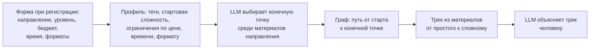
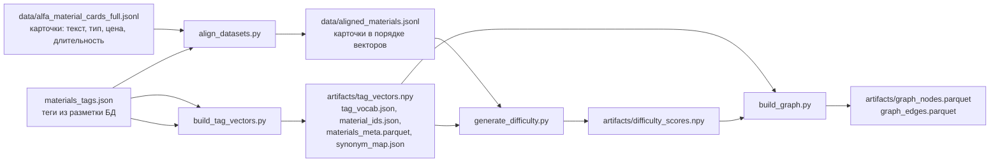

# mf_graph

Граф из 892 материалов «Альфа-Курса». Связи в графе идут от простых материалов к сложным, на основе чего далее строятся учебные треки.

Проект сделан для хакатона «Альфа-Курс», трек 1 (персональные рекомендации образовательных материалов).

## Главное о проекте

**Задача.** Повысить среднюю конверсию в покупку образовательных продуктов и число дней, в которые пользователь заходит на платформу.

**Проблема.** В каталоге большое количество материалов, и пользователю трудно понять, с чего начать и что изучать дальше.

**Идея.** При регистрации пользователь заполняет форму из трёх шагов. Он выбирает направление и уровень подготовки, отмечает, что уже знает, и указывает бюджет, часы в неделю, срок и форматы обучения. Ответы нужны для персональных рекомендаций. По ним собирается профиль, а LLM выбирает конечную точку в выбранном направлении. Далее по графу строится путь от начальной точки до конечной по материалам подходящей сложности. Подробности в разделе [Как это работает для пользователя](#как-это-работает-для-пользователя).

**Что сделали.** Для каждого материала посчитали вектор по темам и тегам и оценку сложности. Похожие материалы соединили связями от менее сложного к более сложному.

**Результат.**
- 6 789 связей между материалами, циклов нет.
- 882 материала из 892 лежат в одной связной части, маршрут можно построить почти от любой точки.
- Пример маршрута из 4 материалов по налоговой теме описан ниже.
- Весь расчёт занимает несколько секунд.

**Связь с прибылью.** Мы предполагаем, что человек, который видит следующий шаг подходящей сложности, дольше остаётся в каталоге и чаще доходит до платных курсов. Гипотеза и план проверки описаны в разделе [Гипотеза влияния на конверсию и план проверки](#гипотеза-влияния-на-конверсию-и-план-проверки).

## Содержание

1. [Быстрый старт](#быстрый-старт)
2. [Пример результата](#пример-результата)
3. [Как это работает для пользователя](#как-это-работает-для-пользователя)
4. [Гипотеза влияния на конверсию и план проверки](#гипотеза-влияния-на-конверсию-и-план-проверки)
5. [С какими материалами работали](#с-какими-материалами-работали)
6. [Архитектура](#архитектура)
7. [Структура репозитория](#структура-репозитория)
8. [Входные данные](#входные-данные)
9. [Запуск подробно](#запуск-подробно)
10. [Переменные окружения, порты, зависимости](#переменные-окружения-порты-зависимости)
11. [Пошаговая проверка](#пошаговая-проверка)
12. [Артефакты](#артефакты)
13. [Как устроен расчёт](#как-устроен-расчёт)
14. [Добавление новых материалов](#добавление-новых-материалов)
15. [Известные ограничения](#известные-ограничения)
16. [Идеи для рекомендаций](#идеи-для-рекомендаций)
17. [Дополнительные инструменты](#дополнительные-инструменты)
18. [Команда и контакты](#команда-и-контакты)

## Быстрый старт

Нужны Docker и Docker Compose версии 2.24 или новее. В корне репозитория выполните:

```bash
docker compose up --build
```

Контейнер запустит все пять шагов и завершится. Результаты появятся в папке `artifacts/`. В конце вывода будет строка `Граф является DAG?: True` и маршрут из 4 материалов. Весь запуск занимает несколько секунд.

Без Docker нужен Python 3.13, затем `pip install -r requirements.txt` и `python run_pipeline.py`. Подробности в разделе [Запуск подробно](#запуск-подробно).

## Пример результата

Проверочный маршрут по налоговой теме. Скрипт берёт самый простой и самый сложный материал со словом «налог» в заголовке и ищет между ними путь по графу.

| Шаг | Материал | Сложность |
|-----|----------|-----------|
| 1 | Как пополнить единый налоговый счёт: видеоинструкция | 0,38 |
| 2, 3 | два промежуточных материала, похожих по теме | растёт |
| 4 | Налоговая реформа 2026 года: что может измениться для ИП и ООО | 0,90 |

Так же можно строить маршрут из любой точки, идя по рёбрам графа к материалам, которые похожи на выбранный и чуть сложнее него.

## Как это работает для пользователя



1. **Форма.** При регистрации человеку обязательно предлагают заполнить форму из трёх шагов. На первом он выбирает направление из 11, например «Налоги и право» или «Продажи и клиенты». На втором он выбирает уровень подготовки (с нуля, знаю основы, есть опыт, работаю в сфере) и отмечает темы, которые уже знает. На третьем он задаёт бюджет, часы в неделю, срок достижения цели и форматы обучения (курсы, статьи и книги, вебинары, подкасты). Ответы нужны, чтобы получить персональные рекомендации, без формы персонального трека не будет. При следующих входах на сайт форму можно заполнить или обновить по желанию. Почти все поля выбираются из списков. Единственное текстовое поле это необязательная цель своими словами, например «Хочу разобраться в налоговой реформе 2026». Она помогает LLM точнее выбрать конечную точку.
2. **Профиль.** Из ответов собирается профиль. Пороги сложности для четырёх уровней лежат в `data/level_mapping.json`. Направление и отмеченные темы переводятся в теги каталога по таблице соответствий. Уровень подготовки задаёт стартовую сложность на шкале графа (от 0,1 до 0,9). Бюджет, часы в неделю, срок и форматы становятся ограничениями трека. Эти шаги выполняет обычный код, LLM для них не нужна.
3. **Конечная точка.** LLM выбирает, к какому материалу или курсу человек придёт в конце. Выбор идёт только из материалов выбранного направления, которые подходят по формату и бюджету. LLM получает их ID и заголовки, поэтому придумать несуществующий материал она не может.
4. **Старт.** Граф находит материал, который лучше всего подходит по теме и стартовой сложности. Темы, которые человек отметил как известные, в начало трека не попадают.
5. **Путь.** Алгоритм Дейкстры ищет путь от старта к конечной точке. Рёбра идут от менее сложного материала к более сложному, поэтому любой найденный путь поднимается по сложности и не зацикливается. Новые материалы получают рёбра по тому же правилу. Такой поиск уже работает в `build_graph.py` для проверочного маршрута. Перед поиском из графа убираются материалы не тех форматов и платные, если выбран бюджет «только бесплатное». После поиска длительность пути сравнивается со сроком и часами в неделю, и слишком длинный трек обрезается до выбранного срока.
6. **Объяснение.** LLM пересказывает трек человеку и объясняет, почему выбраны эти материалы и чем каждый следующий сложнее. Данные для объяснения берутся из общих тегов и разницы в сложности соседних материалов.

Код этого репозитория отвечает за шаги 4 и 5 (граф и поиск пути). Форму и сборку профиля (шаги 1 и 2) делает сайт, шаги 3 и 6 выполняет сервис с LLM, обмен с ним идёт через JSON.

Пример обмена. В LLM уходят ответы формы и список подходящих материалов направления.

```json
{
  "form": {
    "direction": "Налоги и право",
    "level": "zero",
    "goal_text": "Хочу разобраться в налоговой реформе 2026",
    "known_topics": ["Постановка целей"],
    "budget": "Только бесплатное",
    "hours_per_week": 5,
    "deadline": "Комфортно (3-6 месяцев)",
    "formats": ["Статьи/книги", "Вебинары"]
  },
  "catalog": [{"id": "<ID материала>", "title": "...", "type": "article", "difficulty": 0.38, "topics": ["Налоги и законы"]}]
}
```

В ответ LLM возвращает конечную точку. Стартовую сложность и ограничения код берёт из формы сам.

```json
{"end_item_id": "<ID материала из списка>"}
```

Правила, которые нужны для надёжной работы.

- Код проверяет, что `end_item_id` есть в графе. Если ID неверный, запрос к LLM повторяется.
- Если конечная точка проще стартовой или до неё нет пути по рёбрам, код берёт ближайший достижимый материал выше по сложности.
- В запрос попадают только материалы выбранного направления, подходящие по формату и бюджету. Если их слишком много, список сокращается до ближайших к цели.
- Если человек пропустил форму, персонального трека нет. Система показывает стартовую подборку по самой популярной теме, объясняет её порядок и предлагает заполнить форму при следующем входе.
- В LLM уходят только ответы формы (включая текст цели), а также ID, заголовки, типы, сложность и темы материалов. Рядом с полем цели просим не писать личные данные. Персональные данные и тексты материалов не передаются.
- Для платных материалов в объяснении даётся только короткая польза и ссылка на страницу материала, подробное содержание не раскрывается.
- Модель можно заменить: подойдёт внешняя LLM или собственный сервис, лишь бы он принимал и возвращал JSON в таком виде.

## Гипотеза влияния на конверсию и план проверки

Задание не требовало измерять эффект. От команды ждали концепцию: как рекомендации повлияют на бизнес-цели и как это проверить после внедрения. Данных о конверсии в составе предоставленной базы данных не было, поэтому численный эффект будет виден только непосредственно после внедрения нашей рекомендательной системы.

**Как рекомендации влияют на цели платформы.** Без персонального трека новичок сам ищет, с чего начать, и часть людей уходит, не найдя подходящего материала. Форма сообщает системе уровень, цель и ограничения человека, а граф выстраивает путь из материалов по возрастанию сложности. У человека появляется понятный следующий шаг, поэтому он возвращается на платформу в разные дни. По дороге он проходит бесплатные материалы, которые готовят его к платному курсу. В конце трека система предлагает курс, который продолжает этот путь, и такое предложение выглядит уместнее случайной рекламы. Отсюда ожидаемый рост доли тех, кто покупает.

**Гипотезы.** Это небольшие проверяемые предположения о поведении пользователей. Если они подтвердятся, вырастут число дней захода и конверсия в покупку.
1. Пользователь, который видит следующий шаг под материалом, чаще открывает второй материал в той же сессии.
2. Трек с растущей сложностью реже обрывается на первом материале, чем подборка без порядка.
3. Пользователь с готовым треком чаще возвращается на следующий день, потому что у него есть незаконченный путь.
4. Пользователи, которые дошли до конца трека, чаще открывают страницу платного курса, к которому трек ведёт.
5. Пользователи с заполненной формой доходят до конца трека чаще, чем пользователи со стартовой подборкой.

**Как проверить после внедрения.**
1. **Группы.** Контрольная группа видит подборку материалов по той же теме. Тестовая получает персональные треки из графа.
2. **Главная метрика.** Средняя конверсия в покупку образовательных продуктов, то есть доля пользователей, которые перешли от материала к покупке платного курса.
3. **Дополнительные метрики.** Число дней, в которые пользователь заходит на платформу (вторая цель платформы). Ещё считаем клики по рекомендациям и глубину просмотра, то есть сколько материалов прочитано за визит.
4. **Данные.** Журнал просмотров материалов и переходов в покупку с привязкой к пользователю или сессии.
5. **Размер теста.** Перед запуском нужно оценить, сколько пользователей потребуется, чтобы заметить разницу. Для этого нужна текущая конверсия.
6. **Риски.** Часть людей откажется от формы, а оценка сложности по заголовку приблизительная. Если треки покажутся слишком простыми или слишком сложными, эффект будет слабее. Поэтому под материалом нужна оценка «слишком просто» или «слишком сложно».

## С какими материалами работали

Уровень материала по рубрике (шкала от 1 до 3, пять критериев: предварительные знания, термины, глубина, практика, контекст) определяли только по статьям. У статей есть полный текст, на нём рубрика и строится. Размечено 838 статей.

Курсы, вебинары и подкасты будут размечаться так же, по тем же критериям и по той же шкале. Теги и заголовки этих материалов уже есть в каталоге, поэтому в граф они входят.

## Архитектура



Каждый шаг - отдельный скрипт, скрипты обмениваются только файлами. Порядок строк везде одинаковый. Строка `i` в `tag_vectors.npy`, `difficulty_scores.npy`, `materials_meta.parquet` и `aligned_materials.jsonl` описывает один и тот же материал. Скрипт `run_pipeline.py` запускает шаги по порядку и останавливается на первой ошибке.

## Структура репозитория

```
.
├── materials_tags.json          # вход: материал -> теги из разметки БД (892 записи)
├── data/
│   ├── alfa_material_cards_full.jsonl   # вход: карточки материалов (1494 записи, 6 типов)
│   └── aligned_materials.jsonl          # выход шага 1: 892 карточки в порядке векторов
├── artifacts/                   # выход: векторы, сложность, граф
├── align_datasets.py            # шаг 1: сшивает карточки и теги по ID
├── build_tag_vectors.py         # шаг 2: нормализация тегов, синонимы, TF-IDF
├── generate_difficulty.py       # шаг 3: эвристическая сложность
├── build_graph.py               # шаг 4: DAG похожих материалов и проверочный маршрут
├── test_vectors.py              # шаг 5: ближайшие соседи для трёх материалов
├── analyze_tags.py              # дополнительно: аудит тегов (частоты, кандидаты в синонимы)
├── run_pipeline.py              # запускает шаги 1-5 подряд
├── build_form_mapping.py        # дополнительно: таблица соответствий пунктов формы и тегов каталога
├── level_coverage.py            # дополнительно: сколько материалов по направлениям и уровням формы
├── data/level_mapping.json      # пороги сложности для уровней формы (zero, basic, some, working)
├── data/direction_topics.json   # какие темы каталога входят в направления формы
├── tools/                       # дополнительно: подготовка данных из дампа БД
├── Dockerfile, compose.yaml, .dockerignore
├── requirements.txt, env.example
└── tagvectorizer.rar            # архив со снимком этапа векторизации, конвейер его не читает
```

## Входные данные

`materials_tags.json` - массив из 892 объектов, по одному на материал: 838 статей, 33 курса, 13 вебинаров и 8 подкастов.

| Поле | Содержание |
|------|-----------|
| `ItemId` | ID материала (GUID из БД) |
| `ItemType` | `article`, `course`, `webinar`, `podcast` |
| `Title` | заголовок |
| `Topics` | темы, например «Налоги и законы» |
| `Tags` | навыки и действия, например «Построение воронки продаж» |
| `Industries` | отрасль или признак аудитории, например «Без опыта» |
| `Subject` | рубрика сайта, есть только у статей |

Порядок записей в этом файле задаёт порядок строк во всех артефактах.

`data/alfa_material_cards_full.jsonl` - 1 494 карточки, по одной на строку: 838 статей, 355 уроков, 247 документов, 33 курса, 13 вебинаров и 8 подкастов. Конвейер читает поля `material_id` (вида `article:<GUID>`), `material_type`, `title` и `text_clean`. Остальные поля (`description_clean`, `program_text`, `learning_outcomes`, `target_audience`, `duration_minutes`, `pricing`, `access_type_title`, `topics`, `tags`, `parent_courses`, `url` и другие) код сейчас не использует. Уроков и документов нет в `materials_tags.json`, поэтому в граф они не входят.

Данные предоставлены организаторами хакатона и используются только для выполнения задания. Исходные выгрузки нельзя публиковать в открытых репозиториях.

Оба файла получены из дампа PostgreSQL `courses_for_bu`. Как воспроизвести `materials_tags.json`, описано в разделе про [`tools/`](#дополнительные-инструменты).

## Запуск подробно

### Docker

```bash
docker compose up --build
```

Контейнер выполняет `run_pipeline.py` и завершается. Папки `data/` и `artifacts/` подключены как тома, поэтому результат появляется прямо в репозитории. При повторном запуске артефакты перезаписываются.

### Без Docker

Нужен Python 3.13.

```bash
python -m venv .venv
# Windows:  .venv\Scripts\activate        Linux/macOS:  source .venv/bin/activate
pip install -r requirements.txt
python run_pipeline.py
```

Шаги можно запускать по отдельности, в том же порядке.

```bash
python align_datasets.py
python build_tag_vectors.py --input materials_tags.json   # параметры: --no-synonyms, --no-title, --min-df N
python generate_difficulty.py
python build_graph.py
python test_vectors.py
python analyze_tags.py --input materials_tags.json        # аудит тегов, запускать необязательно
```

## Переменные окружения, порты, зависимости

Переменные окружения. Код собственных переменных не читает. В `env.example` лежат только служебные `PYTHONUTF8` и `PYTHONUNBUFFERED`, ключи и токены не нужны. Параметры графа (`TOP_K`, `MIN_SIMILARITY`) заданы константами в начале `build_graph.py`.

Порты. Конвейер работает пакетно, сервера нет, порты не открываются.

Внешние API. Конвейер к ним не обращается. Уровни статей в `tools/article_levels.csv` размечены языковой моделью заранее, код репозитория их не пересчитывает.

Зависимости. Версии зафиксированы в `requirements.txt`: numpy 2.5.4, pandas 3.1.1, scikit-learn 1.9.1, scipy 1.18.1, pyarrow 26.0.1, networkx 3.7. Образ собирается на `python:3.13-slim`.

## Пошаговая проверка

1. Запустите `docker compose up --build` или `python run_pipeline.py`.
2. Сверьте вывод с таблицей. Значения воспроизводятся при каждом запуске.

   | Шаг | Ожидаемый вывод |
   |-----|-----------------|
   | 1 | `Успешно сшито: 892 статей.` и `Готово! Сохранено в data/aligned_materials.jsonl (892 строк).` |
   | 2 | `Векторы: shape=(892, 2138), словарь=2138 токенов`, `нулевых=0` |
   | 3 | `Оценено статей: 892 из 892` |
   | 4 | `Сгенерировано рёбер: 6789`, `Граф является DAG?: True`, `Размер самой большой компоненты: 882 вершин (из 892)` |
   | 5 | для трёх материалов выводятся пять ближайших соседей с общими тегами |

3. В конце шага 4 должен появиться маршрут из 4 шагов: от «Как пополнить единый налоговый счёт: видеоинструкция» (сложность 0,38) до «Налоговая реформа 2026 года: что может измениться для ИП и ООО» (сложность 0,90).
4. Проверьте форму и порядок артефактов.

   ```python
   import numpy as np, pandas as pd, json
   X = np.load("artifacts/tag_vectors.npy")
   d = np.load("artifacts/difficulty_scores.npy")
   meta = pd.read_parquet("artifacts/materials_meta.parquet")
   ids = json.load(open("artifacts/material_ids.json", encoding="utf-8"))
   assert X.shape == (892, 2138) and d.shape == (892,) and len(meta) == len(ids) == 892
   assert abs(np.linalg.norm(X, axis=1) - 1).max() < 1e-5      # векторы L2-нормированы
   e = pd.read_parquet("artifacts/graph_edges.parquet")
   assert (e.source != e.target).all() and len(e) == 6789
   ```

5. Результат детерминирован. После повторного запуска векторы (`tag_vectors.npy`), словарь и оценки сложности остаются теми же.

## Артефакты

| Файл | Содержимое |
|------|-----------|
| `artifacts/tag_vectors.npy` | матрица 892 × 2138, `float32`, строки L2-нормированы, косинус равен скалярному произведению |
| `artifacts/tag_vocab.json` | токен и номер столбца (2 138 токенов: 58 тегов и 2 080 слов заголовков с префиксом `title:`) |
| `artifacts/material_ids.json` | ID материалов в порядке строк |
| `artifacts/materials_meta.parquet` | `row_index`, `item_id`, `title`, `item_type`, `n_raw_tags`, `n_canonical_tags`, `is_empty` |
| `artifacts/synonym_map.json` | применённая карта синонимов, нужна для воспроизводимости |
| `artifacts/difficulty_scores.npy` | сложность, `float32`, значения от 0,1 до 0,9 |
| `artifacts/graph_nodes.parquet` | вершины: `row_index`, `item_id`, `title`, `item_type`, `difficulty`, `price`, `duration_min` |
| `artifacts/graph_edges.parquet` | рёбра: `source`, `target` (номера строк) и `weight` (косинус сходства) |

## Как устроен расчёт

### Шаг 1. Сшивка (`align_datasets.py`)

Из `material_id` карточки убирается префикс типа (`article:`), ID приводится к нижнему регистру. Карточки выстраиваются в порядке `materials_tags.json`. Если материала нет в карточках, скрипт создаёт пустую заглушку с `_is_stub: true`, чтобы порядок не сбился. Сейчас заглушек нет.

### Шаг 2. Векторы (`build_tag_vectors.py`)

Документ материала собирается из токенов двух видов.

- Значения полей `Topics`, `Tags`, `Subject` и `Industries` в нижнем регистре, пробелы заменены на `_`. Латинские буквы-двойники внутри русских слов заменяются кириллицей (например, «horeсa» с русской «с» превращается в «horeca»).
- Слова заголовка длиннее трёх букв с префиксом `title:`. Стоп-слова (служебные слова, годы, «эксперт», «выпуск» и подобные) пропускаются.

Синонимы объединяются по `SYNONYM_MAP`. Например, «законы», «налоги» и «изменения в законах» превращаются в `налоги_и_законы`, «финансы» в `финансы_и_учет`, «первые шаги» в `старт_бизнеса`, «продажи» в `продажи_и_переговоры`. Метки «New» и «💥 New» отбрасываются.

Дальше `TfidfVectorizer` (сублинейный TF, L2-норма) строит матрицу. Скрипт сообщает, сколько материалов получили одинаковые векторы. Сейчас таких 8 групп, 16 материалов.

### Шаг 3. Сложность (`generate_difficulty.py`)

Оценка начинается с 0,5. За каждый маркер новичка в заголовке («основы», «пошаговая инструкция», «как открыть», «чек-лист» и другие) вычитается 0,25. За каждый маркер эксперта («стратегия», «анализ», «банкротство», «налоговый учёт» и другие) прибавляется 0,25. Слово считается совпавшим, если совпали его первые пять букв. Текст короче 1 500 знаков даёт поправку -0,1, длиннее 10 000 знаков даёт +0,1. Курс прибавляет 0,1, вебинар 0,05. Результат растягивается на диапазон от 0,1 до 0,9.

### Шаг 4. Граф (`build_graph.py`)

Для каждого материала берутся 20 ближайших по косинусу соседей, у которых сходство не меньше 0,15. Ребро направлено от менее сложного материала к более сложному, при равной сложности от меньшего индекса к большему. Двусторонних связей нет, поэтому циклов тоже нет. Вес ребра равен сходству.

В конце скрипт проверяет, что граф ацикличен, считает компоненты связности и ищет маршрут алгоритмом Дейкстры. Стоимость ребра равна `1 - сходство`. Маршрут идёт между самым простым и самым сложным материалом, в заголовке которых есть слово «налог».

## Добавление новых материалов

Каталог будет расти, и граф должен это переносить без смены маршрутов у людей, которые уже идут по треку. Поэтому новый материал добавляется вместе с его рёбрами, а старые рёбра не пересчитываются.

1. **Вектор.** Вектор нового материала считается по уже готовому словарю тегов. Слова, которых в словаре нет, пропускаются.
2. **Сложность.** Сырая оценка считается так же, как для остальных материалов. Границы шкалы от 0,1 до 0,9 фиксированы, поэтому значения старых материалов не меняются.
3. **Соседи.** Новый материал сравнивается со всеми старыми, берутся 20 ближайших со сходством не ниже 0,15.
4. **Рёбра.** Ребро идёт от менее сложного материала к более сложному, как и раньше. Граф остаётся без циклов, потому что направление задаёт только сложность.
5. **Обратные связи.** Если новый материал оказался ближе к старому, чем его двадцатый сосед, для этого старого материала добавляется ещё одно ребро.

Для векторизатора и шкалы сложности действует правило версий. Словарь, веса и границы шкалы хранятся как константы. Их пересчитывают только осознанно, когда каталог заметно изменился, и результат считается новой версией графа. Полный пересчёт через `run_pipeline.py` остаётся доступным.

Скорость поиска пути при росте каталога почти не меняется. У каждого материала не больше 20 исходящих рёбер, поэтому на 10 000 материалах их будет не больше 200 000. Узкое место находится в построении графа. Матрица сходства растёт как квадрат числа материалов (около 400 МБ на 10 000 материалах), и для большого каталога её надо считать частями.

Новая тема, которой нет в списке из 17 секторов, добавляется в конец `tools/sectors.json`, порядок старых секторов не меняется.

## Известные ограничения

1. Сложность считается по заголовку. Оценка принимает всего 23 разных значения на 892 материала. Четыре значения (0,424, 0,468, 0,532 и 0,576) покрывают 655 материалов, а на 0,532 приходится 252 материала, у которых нет ни одного маркера. Пороги уровней формы в `data/level_mapping.json` подобраны под эти значения и после пересчёта сложности их нужно пересмотреть (`level_coverage.py` покажет новое распределение). Совпадение по первым пяти буквам даёт ложные срабатывания. Заголовок «Эффективные каналы для продвижения социального бизнеса» набирает три маркера эксперта из-за основ «для п…» («для профи»), «продв…» («продвинутый» и слово «продвижения») и «эффек…» («эффективность»), и получает 0,9. Текст статьи при оценке не читается, учитывается только его длина.
2. Вершины графа не знают цену и время. В `graph_nodes.parquet` у всех материалов `price = 0.0` и `duration_min = 10.0`, это заглушки. Настоящие значения лежат в карточках (`pricing`, `duration_minutes`), но в граф не подключены. Поэтому стоимость пути в маршруте считается только как `1 - сходство`, а фильтры формы по бюджету и сроку работают только после подключения этих полей.
3. Векторы почти целиком состоят из слов заголовка (2 080 из 2 138 измерений). Тегов всего 58, и у многих материалов набор тегов совпадает или почти совпадает (8 групп одинаковых векторов, 16 материалов). Сходство соседей невысокое, медианный вес ребра 0,20.
4. Нет связи с профилем пользователя, и граф не учитывает, что человек уже прошёл.
5. У 91 материала из 892 нет текста: у всех 54 курсов, вебинаров и подкастов и у 37 статей. Для них сложность считается только по заголовку и типу.
6. Граф неполный. У 8 материалов нет рёбер, два материала образуют отдельную компоненту, остальные 882 лежат в одной. Из-за порога сходства 0,15 и лимита в 20 соседей часть разумных связей не попала в граф.
7. Проверочный маршрут условный. Его начало и конец выбираются по минимуму и максимуму сложности среди материалов со словом «налог» в заголовке.
8. Матрица сходства 892 × 892 строится целиком в памяти. Для нескольких тысяч материалов её придётся считать частями.
9. Уроки (355) и документы (247) из карточек в граф не входят.
10. `TOP_K`, `MIN_SIMILARITY` и веса маркеров заданы константами в коде, конфигурационного файла нет.
11. Человек оценивает свой уровень неточно, а сложность материалов считается по заголовку. Поэтому стартовая точка трека приблизительная. Помочь может короткий входной тест из нескольких вопросов.
12. Путь существует не между любыми двумя материалами. Рёбра идут только вверх по сложности, а 8 материалов вообще не имеют связей, поэтому для них трек строится от ближайшего связанного материала.
13. В части направлений и уровней материалов мало. В «Аналитике и данных» всего 8 материалов, на уровне «знаю основы» там нет ни одного. В «Продукте и разработке» и «Инструментах» по 34 материала, на уровне «с нуля» по 3. В «Продажах», «Маркетинге» и «Digital-маркетинге» на уровне «работаю в сфере» по 10-13 материалов. Для таких сочетаний трек получается коротким или не строится. Полная таблица в `data/level_coverage.csv`.
14. Названия в форме и теги каталога не везде совпадают, например «Анализ ЦА» и «Определение целевой аудитории», «Переговоры» и «Ведение переговоров». Для связи нужна таблица соответствий.
15. В форме есть технические навыки (Python, JavaScript, HTML/CSS, Git, английский, SQL, Excel), которых нет в списке из 11 направлений. Для них нужна своя таблица соответствий с тегами каталога.

## Идеи для рекомендаций

Дополнения к схеме из раздела [Как это работает для пользователя](#как-это-работает-для-пользователя), по требованиям трека.

Холодный старт. Форму предлагают при регистрации, а при следующих входах она остаётся по желанию. Если человек её пропустил, стартовый уровень минимальный, а кнопка «Я уже в теме» ставит средний. Потом уровень уточняется по ответам «слишком просто» и «слишком сложно» под материалом. При полном отсутствии данных показываем самые популярные входные материалы.

Профиль и ранжирование. Профиль хранит уровень по каждой теме и список пройденных материалов, а заполняется он по ответам формы. Оценка материала складывается из сходства с целью пользователя и соответствия его уровню, из неё вычитаются затраты на время и цену, приведённые к шкале от 0 до 1. Время и цену можно взять из полей `pricing` и `duration_minutes` в карточках.

Объяснение рекомендации. Если материал `j` предложен после материала `i`, объяснение собирается из общих тегов, разницы в сложности («чуть сложнее предыдущего») и темы цели. Все эти данные есть в векторах и рёбрах графа.

Бейзлайн. Для сравнения берём случайные материалы той же темы. Нужны тестовые профили, например «новичок, налоги» и «действующий ИП, маркетинг». Сравниваем долю рекомендаций с нужной темой и уровнем, а также разнообразие подборки и долю материалов без повторов уже пройденного.

## Дополнительные инструменты

Скрипты из папки `tools/` для запуска конвейера не нужны. Они показывают, откуда взяты входные данные, и содержат второй способ оценки сложности.

| Файл | Назначение |
|------|-----------|
| `load_dump.py` | читает дамп PostgreSQL (`.backup`, формат pg_dump custom) на чистом Python без установки PostgreSQL и возвращает таблицы как DataFrame |
| `build_items.py` | собирает `content_metrics.csv`: длительность, цена, шкалы от 0 до 1, уровень, сектор темы и координаты точки для круговой диаграммы (892 материала) |
| `export_materials_tags.py` | выгружает `materials_tags.json` из дампа, результат совпадает с файлом в корне |
| `score_item.py` | оценивает сложность, цену и время нового материала по рубрике из пяти критериев |
| `article_levels.csv` | уровень (от 1 до 3) для 838 статей по той же рубрике, размечен языковой моделью, 70 статей отобраны для выборочной проверки редактором |
| `sectors.json` | порядок 17 тем-секторов круговой диаграммы, новая тема добавляется в конец |

Запуск выполняется в папке `tools/`. Для чтения дампа достаточно pandas и numpy.

```bash
python build_items.py dump.backup content_metrics.csv
python export_materials_tags.py dump.backup content_metrics.csv materials_tags.json
```

В репозитории две оценки сложности. Граф использует число от 0,1 до 0,9 из `generate_difficulty.py`, оно считается по заголовку. Вторая оценка лежит в `tools/article_levels.csv`. Это уровень от 1 до 3 и баллы по пяти критериям (предварительные знания, термины, глубина, практика, контекст). Она строится по тексту статьи и живёт отдельно, граф её не читает.

## Команда и контакты

Участники: [впишите имена].

Связь: [почта или Telegram для вопросов по проекту].
